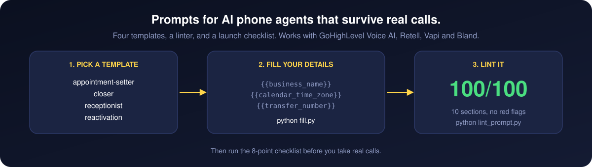
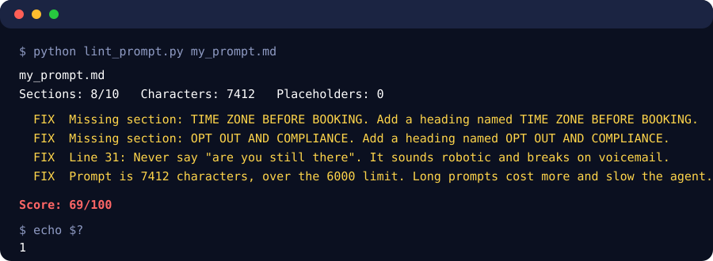

# AI Voice Agent Playbook

Prompt templates for AI phone agents that book, close and answer without embarrassing you. Plus a linter that scores your prompt out of 100.



You get:

- **Four templates:** appointment setter, closer, receptionist, reactivation. Each handles inbound and outbound calls.
- **A linter:** checks your prompt for the 10 sections that matter, flags red-flag phrases, and warns when it gets too long.
- **A filler:** swaps `{{placeholders}}` for your business details and fails loudly if you forgot one.
- **A launch checklist:** the 8 tests to run before real calls come in.

Works with GoHighLevel Voice AI, Retell, Vapi, Bland, and any platform where you paste a system prompt. Python 3.10+, standard library only.

```bash
python fill.py templates/appointment-setter.md examples/vars.example.json > out/setter.md
python lint_prompt.py out/setter.md
```

---

## Why this exists

A voice agent that works in a demo fails on the first real day. It says "are you still there?" to a voicemail. It books 9 am for someone in a different time zone. It tells a caller the job costs $400 because it made the number up. It says "your appointment is booked" when the calendar call failed.

Every rule in these templates came from one of those failures. The prompts are short on purpose. Long prompts cost more per call, respond slower, and make the agent lose track of its own rules.

---

## How it works

1. Pick the template that matches the job.
2. Copy `examples/vars.example.json`, put in your business name, agent name, offer, hours, calendar and transfer number.
3. Run `fill.py` to produce the finished prompt.
4. Run `lint_prompt.py` on the result. Fix anything it flags.
5. Paste the prompt into your voice platform and run the checklist in [docs/checklist.md](docs/checklist.md).

### The 10 sections

Every template has these headings, in this order.

| Section | What it does |
|---|---|
| ROLE AND GOAL | One job, one outcome. |
| OPENING | Separate inbound and outbound greetings. If the first line was the inbound greeting, it is an inbound call. Otherwise outbound. If unsure, assume outbound. |
| VOICEMAIL AND CALL SCREENING | Detects machines, never says "are you still there" to one, leaves a short voicemail, then ends. |
| CONVERSATION RULES | One question at a time. Short sentences. No lists read aloud. Never invent prices or facts. |
| TIME ZONE BEFORE BOOKING | Asks the caller's city, converts from the calendar's zone, confirms both times, books only inside business hours. |
| CONFIRM BEFORE ACTIONS | Reads back name, number, email and time before booking, transferring or sending a link. Never claims an action happened unless the tool returned success. |
| OBJECTION HANDLING | Question-based. Clarify, ask what is behind it, let them say why it matters. Six common objections with example responses. |
| OPT OUT AND COMPLIANCE | Honors do-not-call at once, confirms once, ends the call. Says it is an AI if asked. No medical, legal or financial advice. |
| TRANSFER AND ESCALATION | When to hand off, what to say, what to do if the transfer fails. |
| END OF CALL | Repeat the key details, say goodbye, hang up. |

---

## Install

```bash
git clone https://github.com/yousiful/ai-voice-agent-playbook.git
cd ai-voice-agent-playbook
```

No dependencies. Python 3.10 or later.

---

## Templates

| File | Use it for |
|---|---|
| `templates/appointment-setter.md` | Booking a visit or consult, inbound and outbound |
| `templates/closer.md` | Qualifying, handling objections, sending a payment link or booking a call |
| `templates/receptionist.md` | Answering the phone, FAQs, transfers, taking messages |
| `templates/reactivation.md` | Calling old leads and past customers |

Placeholders you will see:

| Placeholder | Meaning |
|---|---|
| `{{business_name}}` | Your business |
| `{{agent_name}}` | The name the agent uses |
| `{{contact_first_name}}` | Passed in by your CRM on outbound calls |
| `{{offer}}` | What you are booking or selling |
| `{{business_hours}}` | When you take appointments |
| `{{calendar_name}}` | Which calendar the agent books on |
| `{{calendar_time_zone}}` | The calendar's zone, for example `America/Chicago` |
| `{{transfer_number}}` | Where live transfers go |
| `{{callback_number}}` | Number to leave on voicemail |
| `{{pricing}}` | The only prices the closer may quote |
| `{{payment_link}}` | Link the closer sends |
| `{{faq}}` | The only answers the receptionist may give |
| `{{last_contact_context}}` | What old leads did, for reactivation |

The examples use fake businesses. Replace everything with your own.

---

## Fill a template

```bash
cp examples/vars.example.json vars.json
# edit vars.json
python fill.py templates/closer.md vars.json > out/closer.md
```

If any placeholder has no value, `fill.py` prints the missing names and exits 1. It never writes a half-filled prompt.

---

## Lint a prompt

```bash
python lint_prompt.py out/closer.md
```



| Check | Penalty |
|---|---|
| Missing section | 8 points each |
| Red-flag phrase | 5 points each |
| Over the length limit | 10 points |
| Unfilled `{{placeholder}}` | 2 points each, up to 20 |

Red-flag phrases: "are you still there", "as an AI language model", "guarantee", "I promise", "risk free". A line that tells the agent never to say it is fine, so your voicemail rule can name the phrase.

Section matching is fuzzy, so `## 3. Voicemail and call screening` counts.

Options:

| Flag | Default | What it does |
|---|---|---|
| `--max-chars N` | 6000 | Warn when the prompt is longer than this |
| `--min-score N` | 80 | Exit 1 under this score |
| `--template` | off | Treat `{{placeholders}}` as expected. Use it on the raw templates |

Use the exit code in CI to stop a bad prompt from shipping:

```bash
python lint_prompt.py out/closer.md --min-score 100
```

---

## Before you go live

Run the [8-point build standard](docs/checklist.md): test inbound, test outbound, voicemail, opt-out, booking with time zone, transfer, idle reminder at 8 seconds not 4, and review the first 20 real calls.

---

## FAQ

**Which platforms does this work with?**
Any platform that takes a system prompt: GoHighLevel Voice AI, Retell, Vapi, Bland and others. Tool names and webhooks differ by platform, so wire the booking, transfer and do-not-call actions in the platform and keep the prompt wording the same.

**Why is the length limit 6000 characters?**
Long prompts cost more tokens on every turn and slow the first word the agent speaks. If you pass the limit, cut examples and rules that repeat. Change it with `--max-chars` if your use case needs more.

**Why does the agent ask for my city before booking?**
Callers book from phones in other time zones. The calendar runs on one zone. Asking the city and reading both times back stops no-shows caused by a one hour mix-up.

**Can I add my own sections?**
Yes. The linter only requires the 10. Add what you need, keep the length down.

**Is the AI disclosure required?**
Rules differ by state and country, and they are changing. The templates say the agent is an AI if asked. Check the rules where you call, and get advice from a lawyer before you run outbound campaigns.

---

## Running the tests

```bash
python -m pytest tests/
# or without pytest:
python tests/test_lint.py
```

The tests lint every template, fill them with the example variables, and check the failure cases. No network calls, no credentials.

---

## Want AI agents built and running for you?

KenjiAI builds done-for-you inbound and outbound AI call centers.

- **Sign up:** [freedom.kenjiai.com/finishhere](https://freedom.kenjiai.com/finishhere?utm_source=github&utm_medium=readme&utm_campaign=ai-voice-agent-playbook)
- **Book a call:** [go.mediatraffics.com/leads](https://go.mediatraffics.com/leads?utm_source=github&utm_medium=readme&utm_campaign=ai-voice-agent-playbook)
- **Learn more:** [kenjiai.com](https://kenjiai.com/?utm_source=github&utm_medium=readme&utm_campaign=ai-voice-agent-playbook)

---

## More free tools from us

- **[Kenji Clip Engine](https://github.com/yousiful/kenji-clip-engine)**: turn any YouTube video into captioned vertical clips and post them everywhere through Kenji.
- **[No-Website Finder](https://github.com/yousiful/no-website-finder)**: find local businesses on Google Maps with no website and push them into Kenji to pitch.
- **[Meta Ads Kill Switch](https://github.com/yousiful/meta-ads-kill-switch)**: auto-pause any ad that hits your spend limit with zero results.
- **[Reel Editing Toolkit](https://github.com/yousiful/reel-editing-toolkit)**: our full animated reel pipeline.
- **[GHL Client Onboarding](https://github.com/yousiful/ghl-client-onboarding)**: intake form, onboarding checklist and a read-only GHL sub-account audit.
- **[Options Trade Toolkit](https://github.com/yousiful/options-trade-toolkit)**: options pricing, greeks, position sizing and a trade journal.
- **[Voice AI White Label Kit](https://github.com/yousiful/voice-ai-whitelabel-kit)**: agreement template and rebilling margin calculator.
- **[GHL Failed Payment Recovery](https://github.com/yousiful/ghl-failed-payment-recovery)**: win back failed payments from your GoHighLevel clients.

## Feedback and bugs

Something broke, or you want a feature? **[Open an issue](https://github.com/yousiful/ai-voice-agent-playbook/issues/new/choose)**. We read every one and fix what we can. If this saved you time, a star helps other people find it.

MIT License.
